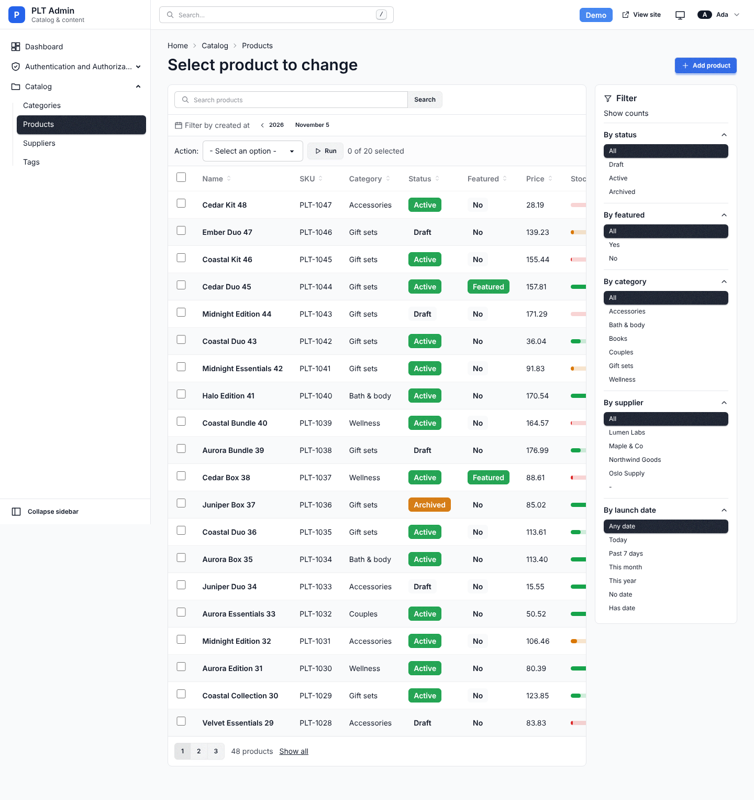
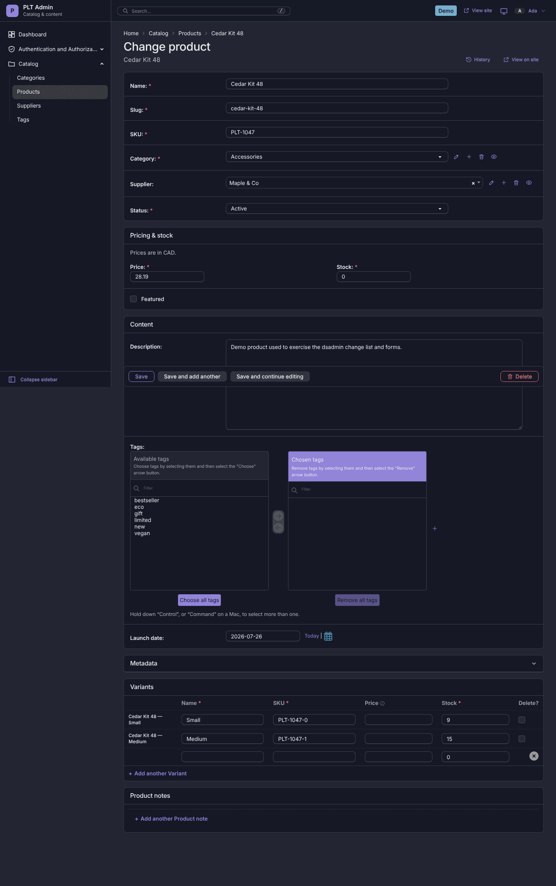
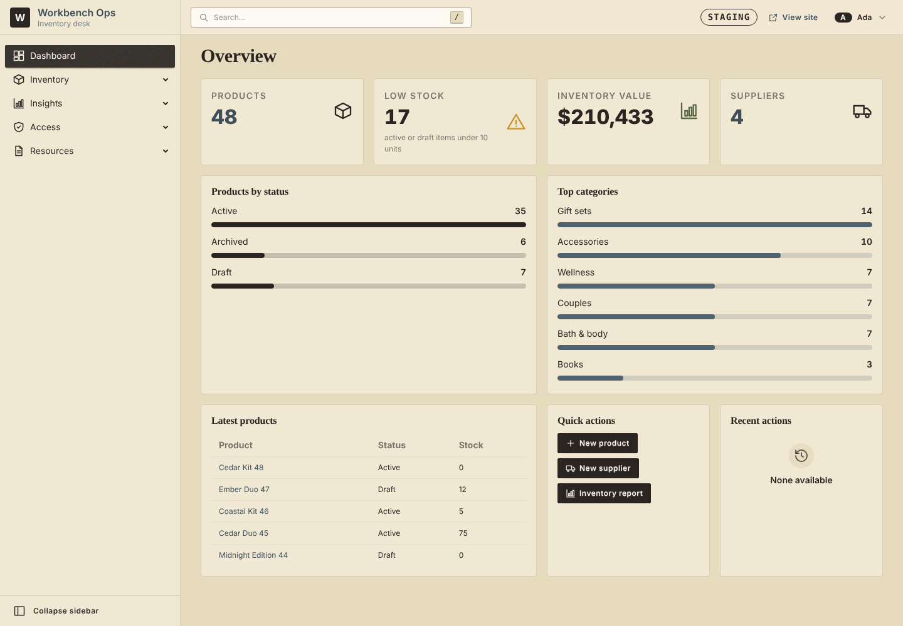

# django-dsadmin

A Django admin presentation framework built on the **PLT design system**
([`@playlovetoys/design-system`](https://github.com/aavendano/plt-design-system):
daisyUI 5 + Tailwind CSS 4, component prefix `d-`).

It re-skins and extends Django admin **without replacing it**: `AdminSite`,
`ModelAdmin`, registration, permissions, CSRF, actions, filters, inlines and
Django's admin JavaScript all stay Django's. dsadmin owns the templates, the
layout and a small set of opt-in extensions.



| Configuration #1 — `admin` theme, settings only | Configuration #2 — `workbench` theme, same package |
| --- | --- |
|  |  |

## What you get

- **Full admin layout** — collapsible sidebar with grouped, permission-filtered navigation;
  sticky navbar; breadcrumbs; global search; messages as alerts; empty, loading and error states;
  responsive drawer on mobile; light/dark/system colour modes.
- **Every stock admin screen** rendered with design-system components — change list
  (table, search, filters, date hierarchy, sorting, pagination, bulk actions, `list_editable`),
  change form (fieldsets, collapsible sections, all widgets, related-object links,
  tabular and stacked inlines), delete confirmations, history, login, password change, popups.
- **Dashboards** from widgets: metric cards, model counts, bar lists, tables, quick actions,
  recent actions, app list, template and JavaScript-island widgets. A failing widget renders an
  error card; it never breaks the page.
- **Custom pages** inside the admin layout (`PageView` or plain functions), auth-wrapped and
  permission-checked, linkable from the navigation.
- **Object actions** (per-object buttons on the change form and change list) with permission
  checks, CSRF, confirmation dialogs and admin-history logging.
- **JavaScript islands** — mount any independent ES module (vanilla, Lit, React, Puck…) with
  ``. No SPA, no React requirement.
- **`list_display` helpers** — `badge`, `boolean_badge`, `progress`.
- **Accessibility** — 0 axe-core violations against WCAG 2.2 AA on the main screens, in light and
  dark mode ([report](docs/evidence/axe-wcag22aa.txt)).

## Install

```bash
pip install django-dsadmin            # or: pip install -e path/to/django-dsadmin
```

```python
INSTALLED_APPS = [
    "dsadmin",                    # must come before the admin app
    "dsadmin.apps.AdminConfig",   # replaces "django.contrib.admin"
    "django.contrib.auth",
    # ...
]
```

That's it. Existing `admin.site.register(...)` / `@admin.register(...)` code keeps working —
`admin.site` is now a `DSAdminSite`. The compiled stylesheets ship in the wheel; consumer
projects need no Node toolchain.

> Prefer to keep stock `django.contrib.admin`? Add only `"dsadmin"` above it. Every admin page
> still renders with the design system (automatic navigation, default theme); `DSAdminSite`
> features (dashboard widgets, pages, global search) need `dsadmin.apps.AdminConfig` or your own
> `DSAdminSite` instance.

Requirements: Python ≥ 3.10, Django 5.2 LTS / 6.0 / 6.1 (all tested).

## Configure

```python
DSADMIN = {
    "SITE_HEADER": "PLT Admin",
    "THEME": "admin",            # any PLT theme built into dsadmin, or a stylesheet URL
    "DARK_THEME": "nocturne",    # None disables dark mode
    "ENVIRONMENT": ("Staging", "warning"),
    "NAVIGATION": None,          # automatic, or a list of groups (see docs)
    "DASHBOARD": None,           # default widgets, or a list (see docs)
}
```

Or build sites in code — several per project, each with its own branding:

```python
from dsadmin import DSAdminSite, widgets as w

backoffice = DSAdminSite(
    name="backoffice",
    site_header="Workbench Ops",
    theme="workbench",
    dark_theme=None,
    navigation=[
        {"label": "Inventory", "icon": "box", "items": [{"model": "catalog.product"}, {"model": "catalog.category"}]},
        {"label": "Insights", "items": [{"page": "inventory-report"}]},
        {"apps": "*"},
    ],
    dashboard=[w.ModelCountCard("catalog.product"), w.RecentActions()],
)
```

## Documentation

| | |
| --- | --- |
| [docs/adoption.md](docs/adoption.md) | Adopting dsadmin in an existing project, step by step |
| [docs/configuration.md](docs/configuration.md) | Every setting, precedence, branding, colour modes |
| [docs/navigation-dashboard-pages.md](docs/navigation-dashboard-pages.md) | Sidebar, dashboard widgets, custom pages, search |
| [docs/components.md](docs/components.md) | Template tags, includes, `display` helpers, object actions |
| [docs/extensions.md](docs/extensions.md) | JavaScript islands (incl. React / Puck), overriding templates |
| [docs/theming.md](docs/theming.md) | How the design system is consumed; building project themes |
| [docs/compatibility.md](docs/compatibility.md) | What is overridden, version matrix, limitations |
| [docs/evidence.md](docs/evidence.md) | Acceptance criteria → verifiable evidence |

## Demo

```bash
cd demo
python manage.py migrate
python manage.py seed_demo          # admin/admin (superuser), editor/editor (staff, limited)
python manage.py runserver
```

- `/admin/` — configuration #1: `admin` + `nocturne` themes, automatic navigation, driven only by
  `settings.DSADMIN`, conventional `ModelAdmin` code.
- `/backoffice/` — configuration #2: `workbench` theme, custom navigation, dashboard, a class-based
  page, a function page with a JavaScript island, object actions.

## Develop

```bash
pip install -e ".[test]"
pytest                                    # 60 tests: CRUD, filters, actions, inlines, permissions, CSRF, XSS, standalone project

cd frontend && npm install
PLT_DESIGN_SYSTEM=../../plt-design-system/packages/design-system node build.mjs   # rebuild the theme stylesheets
```

End-to-end checks (Playwright + Chrome, server running on :8765):

```bash
python tests/e2e/screens.py http://127.0.0.1:8765 screens/        # desktop/mobile × light/dark screenshots
AXE_JS=node_modules/axe-core/axe.min.js python tests/e2e/a11y.py http://127.0.0.1:8765
python scripts/probe_admin.py --migrate                           # adoption probe for any project
```

## License

MIT
